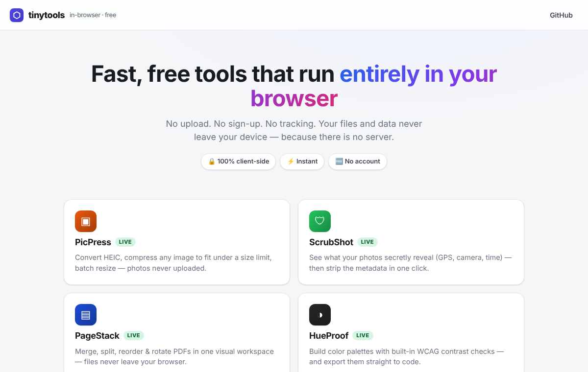

# tinytools

[](https://lilwan345.github.io/tinytools/)


[](LICENSE)

Four free tools that run **entirely in your browser**. No upload, no sign-up,
no tracking, because there is no server: it's static files on GitHub Pages,
and your files never leave your device.

**[Open tinytools →](https://lilwan345.github.io/tinytools/)**

[](https://lilwan345.github.io/tinytools/)

## The tools

| Tool | What it does | How it works |
|---|---|---|
| [**PicPress**](https://lilwan345.github.io/tinytools/picpress/) | HEIC → JPG, compress any photo to fit under a size limit ("max 200 KB"), batch resize, download as a zip | Bisects JPEG quality until the file fits the budget. If even the lowest quality is too big, it shrinks the dimensions and tries again. HEIC is decoded by a lazy-loaded WASM build of heic2any. |
| [**ScrubShot**](https://lilwan345.github.io/tinytools/scrubshot/) | Shows what your photos leak (GPS location, camera, timestamps), then strips it | Lossless byte surgery: it walks the file's segments and drops only the metadata ones (JPEG EXIF/XMP, IPTC and comments; PNG text and EXIF chunks; WebP EXIF/XMP), so not a single pixel is re-encoded. |
| [**PageStack**](https://lilwan345.github.io/tinytools/pagestack/) | Merge, split, reorder, rotate and delete PDF pages in one visual workspace | pdf.js renders the page thumbnails; pdf-lib copies the chosen pages, in your order and rotation, into a new PDF. |
| [**HueProof**](https://lilwan345.github.io/tinytools/hueproof/) | Build a palette with a live WCAG 2.1 contrast matrix, export it to CSS variables, Tailwind, SCSS or JSON | Computes relative luminance and the contrast ratio for every color pair, graded against AA and AAA for normal and large text. |

## Why these four

Each one targets something people search for again and again ("compress
photo to 200 KB", "remove location from photo", "merge PDF") where the usual
answer is an ad-heavy site that uploads your files. Doing it in the browser
is faster and actually private.

I first shipped a different fourth tool, TableShot (pretty table images from
CSV). It competed with a plain screenshot, so I replaced it with PicPress,
which solves a problem people hit every week. TableShot and two earlier
experiments (`badgeforge/`, `ogforge/`, which competed head-on with
shields.io and Canva) stay in the repo for reference but are off the hub.

## Run locally

```bash
./serve.sh        # http://localhost:8000
```

Any static file server works; there is no build step.

## Structure

```
index.html          the hub
picpress/ scrubshot/ pagestack/ hueproof/
                    one self-contained folder per tool (index.html landing page,
                    app.html + app.js + style.css for the tool itself)
shared/             design tokens (theme.css), small helpers (app.js), self-hosted fonts
*/vendor/           pinned third-party libraries, served locally (no CDN calls)
```

## License

MIT, see [LICENSE](LICENSE).
